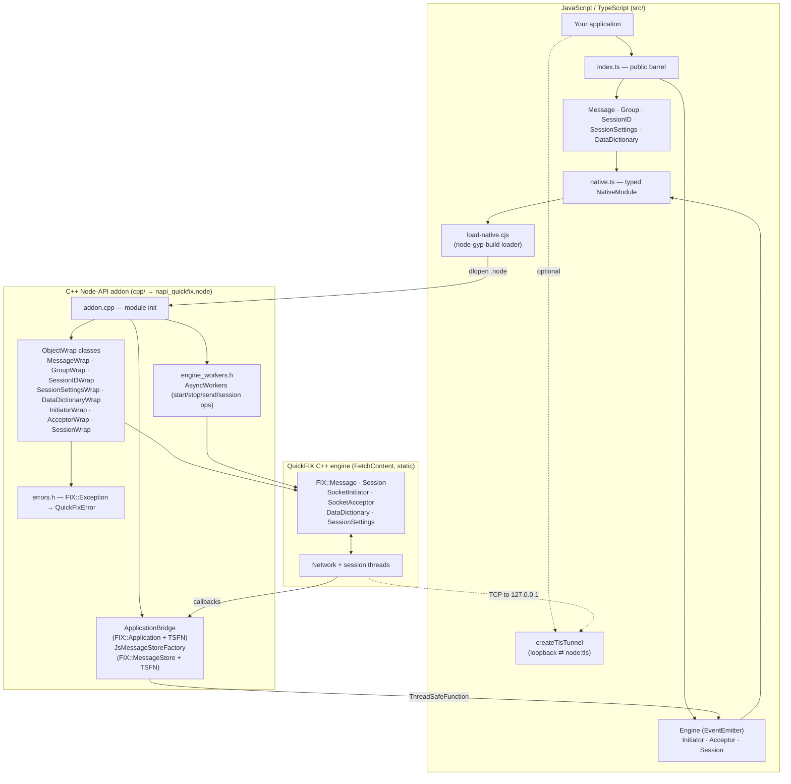
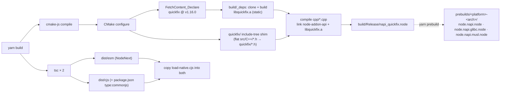
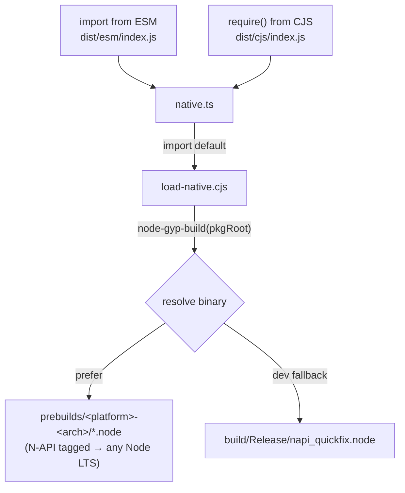
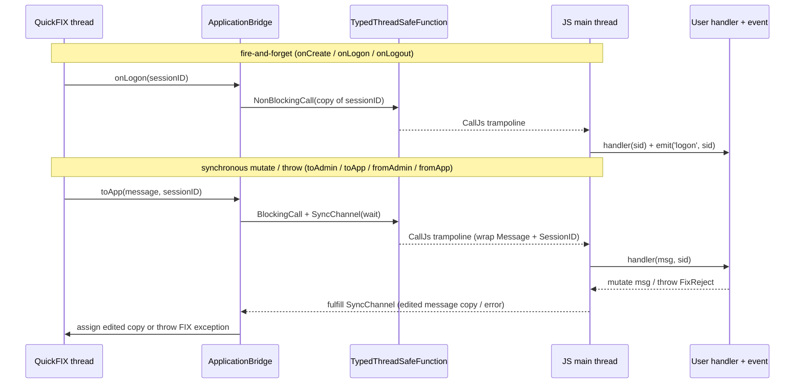
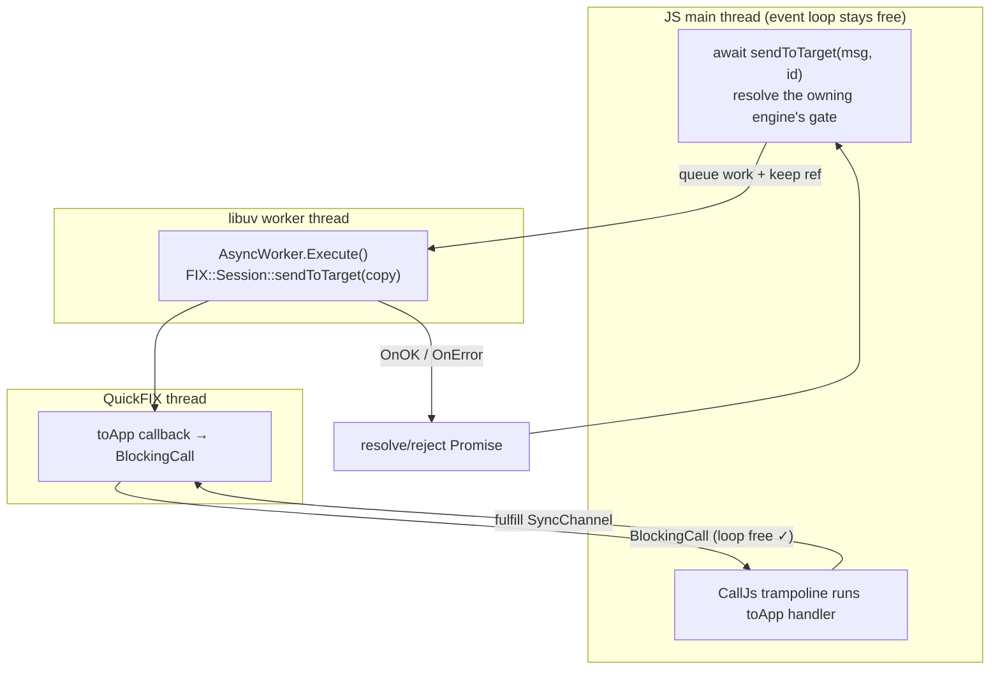
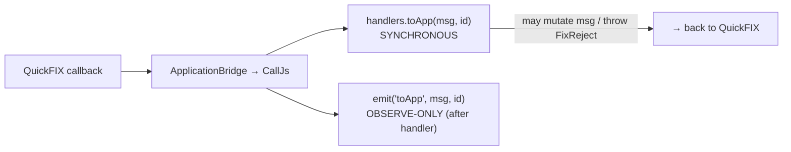
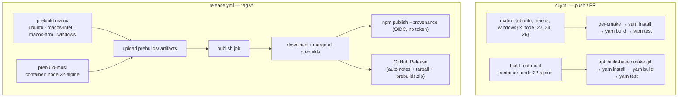

# Architecture

`@homaiohq/napi-quickfix` is a Node.js binding for the [QuickFIX](https://github.com/quickfix/quickfix)
C++ FIX-protocol engine. It has three layers — a **TypeScript public API**, a **C++ Node-API addon**, and the
**QuickFIX engine** (fetched at build time, never vendored) — glued together by a native binary that is prebuilt so
end users need no compiler.

- **Language boundary:** TypeScript ⇄ C++ via [node-addon-api](https://github.com/nodejs/node-addon-api) (N-API v9).
- **Build:** [cmake-js](https://github.com/cmake-js/cmake-js) + CMake `FetchContent` (pins QuickFIX `v1.16.0`).
- **Distribution:** prebuilt `.node` binaries loaded at runtime by
  [node-gyp-build](https://github.com/prebuild/node-gyp-build); dual **ESM + CJS** output.
- **Threading:** blocking engine calls run off the main thread (`AsyncWorker`); QuickFIX callbacks marshal back to JS
  through a `TypedThreadSafeFunction`.

---

## 1. Layered overview



The TypeScript layer is a thin, ergonomic facade. Each TS class holds an opaque handle to its C++ `ObjectWrap`
counterpart. The C++ layer owns the QuickFIX objects and translates every exception into a JS `QuickFixError`
(with a stable `.fixErrorName` discriminator).

TLS is not done by QuickFIX: the engine is built without `HAVE_SSL`, because bundling OpenSSL would break the
one-N-API-prebuild-per-platform model. Instead, `createTlsTunnel` (`src/tls-tunnel.ts`, pure TS) plays the stunnel
client. The plain `SocketInitiator` connects to its loopback listener, and the tunnel carries each connection to the
counterparty over `node:tls`. The tunnel and the engine are independent; the user wires the tunnel's port into the
settings.

---

## 2. Build pipeline

Nothing from QuickFIX is committed. CMake fetches and statically links it at build time; the result is a single
`.node` binary. End users install a **prebuilt** binary and skip this entirely.



Key detail: QuickFIX ships headers **flat** in `src/C++/*.h` but code includes them as `quickfix/Message.h`, so
`CMakeLists.txt` copies them into a generated `quickfix/` include tree at configure time (Windows-safe, no symlinks).

---

## 3. Module loading (dual ESM + CJS)



The loader is one authored `.cjs` file copied into both build outputs, so ESM and CJS resolve the exact same binary
from the package root. The `napi` tag means a single prebuild per platform serves Node 22, 24 and 26.

**One environment at a time, many environments per process.** The addon is context-aware: Node runs its `Init` once
per environment that imports it, which with `worker_threads` is the main thread plus every Worker. Anything `Init`
creates for an environment, in particular the constructors of the exported classes, is therefore kept in that
environment's **instance data** (`AddonData`, `cpp/addon_data.h`, set with `env.SetInstanceData`) and read back with
`AddonData::Get(env)`, never in a module static: a static `Napi::FunctionReference` is a reference into *one*
environment, and the next Worker's `Init` would overwrite it, deleting the previous environment's reference from the
wrong thread and leaving the main thread building its instances from a dead one. The state that *is* process-wide
is QuickFIX's own session registry (`FIX::Session::lookupSession` is keyed by `SessionID` across every environment)
and the `SessionOpGate` registry that mirrors it, both mutex-protected; a `SessionID` live in one Worker is a
"Duplicate Session" in another.

---

## 4. The Application bridge (C++ threads → JS)

QuickFIX invokes `FIX::Application` callbacks from its **own network/session threads**. `ApplicationBridge`
subclasses `FIX::Application` and forwards each callback to JS through a single `Napi::TypedThreadSafeFunction`.



- **Fire-and-forget** callbacks never block the QuickFIX thread.
- **Synchronous** callbacks (which may mutate the outbound message or throw to reject) use a `BlockingCall` plus a
  shared `SyncChannel` (mutex + condition variable). An RAII guard **always** fulfils the channel — even if the JS
  handler throws — so the QuickFIX thread can never deadlock waiting on it.
- The message crosses the bridge as a **deep copy of the `FIX::Message`** in both directions, never as its wire
  string. QuickFIX parsed it with the session's data dictionary, so its repeating groups are structured; re-parsing
  a string without that dictionary would flatten them, and `getGroup` in a handler (or a group added in `toApp`)
  would be lost.
- The message also carries the **session dictionary**, so `setField` & co. route its header/trailer fields as the
  parser does. The bridge caches, per session, a copy of the session's `DataDictionaryProvider` (which shares its
  dictionaries' ownership) taken on the QuickFIX thread, so a message kept by JS can outlive its session safely.
- The trampoline (`CallJs`) **catches what a stopping environment throws** and lets the callback pass through; any
  other `Napi::Error` (a throwing handlers getter, a failed wrapper) is rethrown and surfaces as an uncaught
  exception, and any other C++ exception is swallowed, since it would `std::terminate` the process. A Worker's
  `terminate()` marks its environment unable to call into JS from the parent thread, at any moment, while the
  Worker's loop still dispatches what the TSFN holds (and the callback whose handler is running): from then on every
  Node-API call that may run JS fails, and the node-addon-api wrappers throw a `Napi::Error` for it, which the
  trampoline treats exactly as it treats a callback arriving after `Deactivate()`. The one failure the wrappers
  cannot build their error for is a handler interrupted mid-call: V8 reports the termination as a pending exception
  whose value is `null`, and wrapping a non-object exception needs a call that fails in a stopping environment and
  would abort the process. The build defines `NODE_API_SWALLOW_UNTHROWABLE_EXCEPTIONS` (`CMakeLists.txt`) so that
  node-addon-api treats that failure as success; the trampoline then probes the environment (`CanCallIntoJs`, only on
  that failure path) to tell an interrupted handler from one that threw, so the interruption is not reported to
  QuickFIX as a throw.

---

## 4b. The message-store bridge (JS store → C++ threads)

`JsMessageStoreFactory` / `JsMessageStore` (`cpp/js_message_store.{h,cpp}`) implement QuickFIX's `MessageStore`
over a JS `MessageStoreAdapter`, so session state can be persisted write-through in any database Node can reach
without a client library in the prebuild. The direction is the reverse of the Application bridge: QuickFIX calls the
store synchronously, under `SessionState::m_mutex`, from whichever thread touched the session, and that thread has to
wait for a JS result.

```mermaid
sequenceDiagram
  participant QF as QuickFIX / libuv thread (holds SessionState mutex)
  participant ST as JsMessageStore
  participant TSFN as store TSFN
  participant JS as JS main thread
  participant AD as TS bridge → user adapter

  QF->>ST: set(seq, msg) / incrNextSenderMsgSeqNum() ...
  ST->>TSFN: BlockingCall + Channel(id), wait with deadline
  TSFN-->>JS: CallJs trampoline
  JS->>AD: bridge.setMessage(sid, seq, msg)  (always a Promise)
  AD-->>JS: promise.then(onFulfilled.bind(id), onRejected.bind(id))
  JS-->>ST: continuation looks the channel up by id, fulfils it
  ST->>QF: return / throw IOException; cache updated after the ack
```

- **Dispatch rule.** On the JS thread (the engine constructor's `reset()` for a session built outside its session
  time) the bridge is called directly and the Promise is not awaited: the TS `StoreBinding` collects it and
  `Initiator.create()` awaits it, tearing the engine down on rejection. On every other thread the call goes through a
  **dedicated** `TypedThreadSafeFunction` with `BlockingCall` and a promise-aware channel (`cpp/sync_channel.h`, the
  same `SyncChannel` + `PendingChannels` the Application bridge uses), released by the promise continuation, by the
  per-call deadline (`storeTimeoutMs`), or by `Deactivate()`/`Abort()` during teardown (→ "aborted" → `IOException`,
  never a fake success). The TS layer never calls native directly for the adapter's `load()`/`create()` of
  `create()`'s preload, nor for `close()`: both happen in TS, before the engine exists and after `stop()` settled.
- **Cache.** Sequence numbers and the creation time live in a `MemoryStore` cache (upstream's `PostgreSQLStore`
  layout), updated **after** the adapter acknowledged (upstream's `incr*` bump the cache first), so a rejected write
  leaves cache and database equal. The engine's getters read it; `SessionWrap::getExpected*` on the JS thread read
  it through a process-wide `SessionID → JsMessageStore` registry, written only on the JS thread, without entering
  `FIX::Session` (whose getters take `SessionState::m_mutex`, see §5).
- **Continuation lifetime.** The two continuations are created once per factory and bound per call to a channel id
  (`Function.prototype.bind`); they capture a `shared_ptr` to the pending-channel registry, never a channel, so no
  per-call native closure — and no finalizer running at GC time — ever races the waiting thread for the channel's
  ownership (the spike's TSan finding). The waiting thread registers the channel, waits, and erases it; a
  continuation finds it by id under the registry lock and fulfils it there. A channel whose waiter timed out stays
  registered as *expired*, so the continuation that settles it later can tell it was **late** and let the store
  record that (poison bookkeeping) before erasing it.
- **Failure policy** (README "Message store"): `setMessage`/`getMessages` failures are `IOException`s QuickFIX
  already handles; `setSeqNums`/`reset` rejections, timeouts and late settlements, and `load` failures, **poison**
  the store (every write throws until a reload through `load()` succeeds, after every timed-out write has settled; a
  failed `reset` is instead retried with its original timestamp, since a reload would bring back the numbers QuickFIX
  meant to discard). A message stamped from the cache of a poisoned store is refused at `persist()` if the reload
  that lifted the poison moved the sender seqnum (`CheckStamp()`; `incrNextSenderMsgSeqNum()` with
  `PersistMessages=N`). Sequence numbers cross the bridge as doubles: `ReadSeq()` refuses a value above
  2^53-1 coming back from JS, and `CheckSafeSeq()` refuses one going out (`set()`, `setNext*()`, hence `incr*()`;
  reachable by a counterparty's `SequenceReset` with a 64-bit `NewSeqNo`) before `Forward()`, as a non-poisoning
  `IOException` + `storeError` (nothing reached the adapter), which QuickFIX's handler turns into a disconnect.
  Five members never throw into QuickFIX, because each has a call site with no
  handler: `reset()` (`Session::disconnect()` with `ResetOnDisconnect=Y` runs inside `Session::next()`'s own
  `catch (IOException&)`); `refresh()`, `getCreationTime()` and `getNextSenderMsgSeqNum()` (`Session::setResponder()`
  on the connect path runs `refresh()`, `checkSessionTime()` and, outside the session period, `Session::reset()`,
  whose `generateLogout()` → `fill()` reads the sender seqnum before `sendRaw()`'s `try`: the acceptor has no handler
  there, `std::terminate`; the initiator swallows the exception with the session stuck "pending" for good;
  `catch (RejectLogon&)`/`catch (UnsupportedVersion&)` call `generateLogout()` too); and `getNextTargetMsgSeqNum()`
  (`Session::next(Message)` reads it in `nextQueued()` after its handlers, on every inbound message). The writes poison
  and report; the getters attempt the reload, then return the cache. No stale number reaches the wire:
  `persist()`'s writes still throw inside `sendRaw()`'s `try`. A poisoned initiator's Logon therefore fails at
  `persist()` after `generateLogon()` marked it sent, and the attempt ends at `LogonTimeout`. Inside one of
  QuickFIX's own catch handlers (`std::current_exception()` set) `incrNextTargetMsgSeqNum()` does not throw either:
  `catch (UnsupportedVersion&)` increments the target seqnum unguarded (`std::terminate`, observed). A late
  settlement can race the timed-out waiter's own bookkeeping (it counts the write only after `Call()` returned), so
  the unsettled counter is not clamped at 0: it may read -1 for a moment. A reload whose `load()` returns `null`
  (the row is gone) recreates it at 1/1 through `create()`, as upstream's `refresh()` → `populateCache()` does; a
  timed-out `create()` there is tracked as an unsettled write like `setSeqNums`/`reset`. The calls the TS layer makes
  itself (preload, the constructor-time `reset()`, `close()`) are bounded by the same timeout in `src/store.ts`
  (`withTimeout()`). `storeError` events originate in native (only it knows about timeouts, late settlements and poison), through
  a callback on the TS bridge object: called directly on the JS thread, or queued through the store TSFN from a
  waiting thread. The session-log event is written only from the waiting thread, which already holds
  `SessionState::m_mutex` (re-entrant for its owner); the JS thread must never take it.
- **Teardown** mirrors the Application bridge on every path: `Teardown()` deactivates the store bridge *before* the
  Application bridge and before the force-stop (a network thread parked in a store call holds the mutex
  `Initiator::stop()` takes); `stop(true)` deactivates it on the JS thread before queuing the stop worker; a graceful
  `stop()` keeps it serving (its writes are legitimate, each bounded by the timeout) and releases it in
  `DestroyStoppedEngine()`, where the rooted bridge object is dropped too (#28 shape); `ref()`/`unref()` apply to both
  TSFNs. The trampoline refuses to run the adapter once deactivated, so a call nobody waits on cannot land after
  `close()`.

---

## 5. Why `start` / `stop` / `sendToTarget` are async

These calls make QuickFIX invoke synchronous callbacks that must round-trip to the JS main thread. If they ran **on**
the main thread, the main thread would block waiting for a `BlockingCall` that only the (now-blocked) event loop can
service — a deadlock. The fix: run the blocking QuickFIX call on a libuv worker thread via `Napi::AsyncWorker` and
return a `Promise`, keeping the event loop free to run the bridge trampoline.



Synchronous, non-blocking members stay sync: `isLoggedOn()`, `getSessions()`, `getSession()`, `ref()`, `unref()`,
and the entire pure layer (`Message`, `SessionID`, `SessionSettings`, `DataDictionary`). On GC/process exit, a
cleanup hook deactivates the bridge and force-stops the engine **before** the TSFN is torn down, so a live session
never crashes on shutdown.

The promise a `start()`/`stop()` returns is the AsyncWorker's own. The early-return cases (already started or
stopped, a call in progress, the engine gone) build theirs where they settle it (`ResolvedPromise` /
`RejectedPromise`, `engine_workers.h`): a `Napi::Promise::Deferred` created up front and then not used is never
settled, and its `napi_deferred` is a strong handle that roots the Promise for the rest of the process — one per
call, which is how 0.3.1 leaked.

### `Session`: which members are synchronous

`SessionWrap` is a handle on an engine-owned `FIX::Session`. The rule for what may run on the main thread is the
lock, not the I/O: a main-thread call must never take a mutex that another thread may hold **while it waits on the
JS event loop**. Two QuickFIX mutexes are held that way. `Session::m_mutex` (`S`) is held across application
callbacks (`sendRaw` holds it across `toAdmin`/`toApp`; `disconnect` across `onLogout`), each a `BlockingCall` that
needs the loop. `SessionState::m_mutex` (`SS`) is held across every message-store call (`SessionState::set`,
`incr*`, `get`, `reset`, `refresh`, and the getters `getNext*`/`getCreationTime`), and with a JS message store
(§4b) each of those is a wait on the loop too, from whichever thread runs it: the engine's network thread, or a
`sendToTarget` libuv worker running `Session::sendRaw`. A main-thread call taking `S` or `SS` would then wait on a
thread that is waiting on the main thread: a deadlock of the whole process, reproduced for `SS` in the issue #29
spike. The members split accordingly:

| Members | Thread | Why |
| --- | --- | --- |
| `isLoggedOn` · `isEnabled` · `sentLogon` · `sentLogout` · `receivedLogon` · `isInitiator` · `isAcceptor` · `isSessionTime` · `isLogonTime` · option getters/setters | sync, main | Read/write plain members of `FIX::Session`; no lock, no callback. |
| `getExpectedSenderNum` · `getExpectedTargetNum` | sync, main | For a `file`/`memory` store: `FIX::Session::getExpected*` → `SessionState::getNext*` under `SS`, which no thread holds across a wait on the loop in that configuration (the store is in-process). For a JS store the handle bypasses `FIX::Session` and reads the `JsMessageStore` cache under the store's own leaf mutex (§4b); `SS` is never taken on the main thread. |
| `setNextSenderMsgSeqNum` · `setNextTargetMsgSeqNum` · `logon` · `logout` · `refresh` | `SessionOpWorker` (libuv), Promise | Each takes `SS` (`setNext*`/`refresh` through the store; `logout`/`logon` through `logoutReason`), so they run on a worker under the engine's `SessionOpGate`, exactly like `SendToTargetWorker`: the loop stays free to serve the store call the holder is waiting on. The TS `Session` serialises the five per session (a module-level chain keyed by `sessionID.toString()`, since every `getSession()` hands out a fresh handle), so `logout(); logon();` still lands in program order. Their latency is that of the pool: they queue behind in-flight `sendToTarget` workers, each of which may be parked in a store write. The setters are not serialised against the engine, though: `Session::sendRaw` holds `S` across `fill()` (reads the next sender num into the header), `toApp`/`toAdmin` and `persist()` (`incrNextSenderMsgSeqNum`), and `Session::next()` across the target-num check, `fromApp`/`fromAdmin` and `incrNextTargetMsgSeqNum`; a setter landing inside that window is overwritten by the increment and the session ends up one off from the peer. The setters are for a quiescent session (before `start()`, from a `'logout'` event, never from a handler). `enabled` is a plain `bool` that `logon`/`logout` write with no lock while the network thread reads it in `Session::next()`: formally a data race, the same one `Initiator::stop()` makes from the stopping thread, benign in practice (the flag is picked up on the next pass; the TSan baseline over the suite reports nothing in `FIX::` frames). A `'logout'` listener fired by a graceful `stop()` that calls `setNext*` either runs before the stop worker's `Freeze()` and succeeds, or parks on the gate until the engine is destroyed and rejects `SessionNotFound`. |

`FIX::Session::disconnect()` and `reset()` (which calls it) are **not exposed**, and not only because they take
`m_mutex` and fire callbacks (that alone would just make them AsyncWorkers, like `sendToTarget`). Through the
session's responder they reach `FIX::SocketMonitor::drop()`, which erases from the monitor's socket sets and pushes
onto its dropped queue with **no lock**, while the engine's network thread iterates those same sets in
`SocketMonitor::block()`. QuickFIX only ever calls them from that thread itself (timeouts, logout handling,
remote disconnects); from any other thread they are a data race with a crash window of a few instructions
(upstream quickfix/quickfix#346, closed "not planned"). There is no public hook to run code on the network thread,
and this binding does not patch QuickFIX, so the supported way to bring a session down is `logout()` — exactly
what `Initiator::stop()` itself does — and to renumber it, the sequence-number setters.

**Lifetime.** `FIX::Session` objects are owned by the engine and `FIX::Session::lookupSession` returns a raw,
non-owning pointer, so `SessionWrap` never caches it: it stores the `FIX::SessionID` by value and re-resolves on
**every** call, throwing `QuickFixError{fixErrorName: 'SessionNotFound'}` when the session is gone. The registry
`lookupSession` reads is keyed by `SessionID` alone, and a stopped engine's ids may be taken by a new engine (below),
so re-resolving the id is not enough: a handle also holds the `shared_ptr<SessionOpGate>` of the engine that owned
the session when it was created (`NewInstance`; `engine.getSession` passes its own gate, `lookupSession` the
registered one) and `Resolve()` requires `SessionOpGate::Lookup(id)` to still return that gate before it calls
`lookupSession`. Engines are created and destroyed on the JS thread, as is `Resolve()`, so the check cannot race;
the gate stays registered until the engine is destroyed, so a `'logout'` listener fired by a graceful `stop()`
still resolves. A handle not created through `NewInstance` (the exported constructor) has no gate and always
throws. QuickFIX only deletes sessions — and removes them from the registry
`lookupSession` reads — in the engine destructor, so `InitiatorWrap`/`AcceptorWrap` destroy their engine as soon
as `stop()` settles (all network threads are joined by then) rather than waiting for GC. That is what makes a stale
`Session` handle fail deterministically after `stop()`, and lets a new engine reuse the same `SessionID`s right
after the old one has been stopped. The same point is where the wrap breaks the only cycle that could keep it
alive: the bridge holds the handlers object strongly (so a started engine stays reachable through them, like a
`net.Server` through its listeners), the handlers close over the `Engine`, and the `Engine` holds the wrap — a
cycle through native memory the GC cannot see. `DestroyStoppedEngine()` calls `ApplicationBridge::DropHandlers()`,
which also frees the per-session dictionaries the bridge cached for its `Message`s; neither `Release()` nor
`Abort()` does, because callbacks queued before a graceful `Release()` (the `'logout'` events `stop()` fired) are
still dispatched afterwards and read the handlers. A wrap dropped without `stop()` keeps everything, and its TSFN
keeps the event loop alive, until the process exits. A `SessionID` that is still live is refused: both wrap constructors throw
`ConfigError` "Duplicate Session" (`RejectDuplicateSessions`, `engine_common.h`). QuickFIX itself does **not**
enforce that — its `Session` constructor ignores `addSession()`'s result and the only upstream "Duplicate Session"
check is within one `SessionSettings` — so without it a second engine silently shadowed the first in the registry.
The check has a corollary: `Initiator`/`Acceptor::initialize()` creates the sessions one `[SESSION]` at a time and,
if a later one throws `ConfigError`, unwinds without the engine destructor that would delete the ones already
created — they would stay registered with no owner, resolvable through `lookupSession` yet refused as duplicates
by every later engine. Both wrap constructors therefore catch the throw and delete those orphans
(`DestroyOrphanedSessions`, `engine_common.h`): the duplicate check just before guarantees every session of theirs
that exists at that point was created by the failed constructor. The same unwinding leaks the **engine-level
`Log`** that the `Initiator`/`Acceptor` constructor requests from the `LogFactory` (`create()` with no `SessionID`)
before `initialize()` runs — only the engine destructor hands it back, and QuickFIX's `FileLogFactory` does not
reclaim it either, so with `log: 'file'` each failed construction left two open streams. The wraps therefore hand
the engine a `TrackingLogFactory` (`engine_common.h`) that forwards to the real factory and remembers that `Log`;
on a failed construction they destroy it next to the orphaned sessions.

That eager destruction races with the worker-thread operations above, which hold a raw `FIX::Session*` between
`lookupSession` and the end of the operation. `session_op_gate.h` closes the race with a **per-engine** gate.
Each wrap owns a `shared_ptr<SessionOpGate>` and registers it for its `SessionID`s at construction (the duplicate
check above is what keeps the registry one-to-one). `sendToTarget()` resolves the gate of the engine owning the
id on the **JS thread**, before it queues its `SendToTargetWorker` (deriving the id from the message header first,
for the qualifier form); engines register and unregister on that thread only, so the lookup is exact and the send
is bound to the engine that owned the session when it was called — an engine registered later for the same id can
never be the one it runs on, however long the worker sat in the libuv queue. No registered gate means no engine
owns the session, refused as `SessionNotFound` without queuing anything. The worker then calls
`SessionOpGate::Acquire(gate, id)` on its thread and holds the returned `OpScope` for its whole `Execute()`.
`Acquire` re-reads the registry *after* the scope is held and keeps it only if the same gate is still the owner:
constructing the scope may have blocked across the owner's destruction, and a new engine may own the id by then —
holding the old gate would let the new engine's `stop()` destroy the session mid-operation. In that case the
operation is refused (`SessionNotFound`), not retried against the new owner: it was queued for the engine that is
gone, and sending it through the new engine's session (not logged on, so persisted in its store and sent on its
first logon) would be the cross-over `SessionWrap::Resolve()` refuses for `Session` handles. The engine's stop worker — on its **own** libuv thread, after `stop()`
has joined the network threads — calls `Freeze()` on *its* gate, which blocks new operations on *its* sessions and
waits for the in-flight ones to drain. Waiting on the worker thread rather than on the JS thread matters: an
in-flight `sendToTarget()` may be blocked in a `toApp` `BlockingCall`, which needs the JS loop free. A never-started
engine takes the same async path on `stop()`, since its sessions are registered from construction.

The destruction itself (unregister, delete the engine, `Unfreeze()`) runs on the JS thread, but **not** straight
from the worker's `OnOK`: the `'logout'` events a graceful `stop()` fired are fire-and-forget TSFN calls still
queued in the bridge, and nothing orders their dispatch before the AsyncWorker completion. So for a graceful stop
`OnOK` queues the destruction — together with the settlement of the `stop()` promise and the owner reference that
keeps the wrap alive — through the bridge's own FIFO (`ApplicationBridge::RunAfterQueued`, a `kBarrier` item)
behind those events, then releases the TSFN; the TSFN is ref'd for that drain so an `unref()`'d engine's `stop()`
still resolves. `stop(true)` aborts the TSFN (discarding queued events) and destroys immediately. If `stop()`
itself threw, the engine is left intact, the gate unfrozen and `stopped_` cleared so a later `stop()` or the
destructor's `Teardown()` retries — the network thread may still be running, so destroying would be unsafe.
`Teardown()` (the env cleanup hook and the destructor) runs once, keyed on its own `tornDown_` flag rather than on
`stopped_`, which is set for the whole duration of an in-flight `stop()`: if the stop worker is still running, it
first deactivates the bridge (waking any `BlockingCall` the worker's `Freeze()` may be waiting behind) and then
waits for the worker's operation to return (`StopCompletion`, `engine_workers.h`) before force-stopping — a no-op if
the worker's `stop()` completed — and destroying the engine. Node drains the thread pool before it runs cleanup hooks
or finalizers, so that wait is expected to return at once; it makes the ordering a property of this code rather
than of Node's shutdown sequence.
Because the settlement is deferred, `stopped_` is set long before the engine is gone; a `stop()` made in that
window (typically from the `'logout'` listener the stop fired) must not resolve on the strength of `stopped_`
alone. The wrap keeps a reference to the in-flight stop's promise (`stopPromise_`) until it settles and returns
that same promise to any `stop()` made meanwhile, whatever its `force` argument.

The gate is per engine, not process-wide, for two reasons. Stopping engine A must not stall engine B's operations,
nor wait on them. And the wrap **destructor** (GC, JS thread) also freezes before destroying its engine: with one
gate per engine that only waits for operations on *this* engine's sessions, which cannot be blocked on the JS
thread because `Teardown()` has already deactivated this bridge and joined these network threads. A process-wide
gate would have made that finalizer wait for *another* engine's operation blocked in a `BlockingCall` that only the
JS thread can service — a deadlock.

Until `stop()` settles the engine is alive on the JS thread, so `engine.getSession()` / `engine.isLoggedOn(id)`
keep answering during a graceful stop (a `'logout'` listener can still read the final sequence numbers).

### Lock order

The locks and the two scheduling resources that behave like locks, with the order in which a thread may hold them
(`X → Y`: holds `X` while acquiring or waiting for `Y`):

| Symbol | What |
| --- | --- |
| `E` | `Initiator`/`Acceptor::m_mutex` (engine) |
| `R` | `Session::s_mutex` (the process-wide session registry; a leaf) |
| `G` | `SessionOpGate` (an `OpScope` in flight / `Freeze()` waiting) |
| `S` | `Session::m_mutex`, held across application callbacks |
| `SS` | `SessionState::m_mutex`, held across every message-store call |
| `LOOP` | the JS event loop as a resource: every `BlockingCall` waits for it to be free |
| `POOL` | a libuv threadpool slot (`UV_THREADPOOL_SIZE`, default 4) |
| `C` | `JsMessageStore`'s cache mutex (a leaf, never held across a JS call) |

```
E → R ;  POOL → G → S → SS → {LOOP, C} ;  SS → LOOP ;  SS → R (session-log event) ;
never LOOP → SS outside engine construction/destruction ;  never C → anything ;
an adapter's hot path → never POOL
```

`SS` is held by "a QuickFIX or libuv thread": the engine's network thread, a `sendToTarget` worker running
`Session::sendRaw`, a `SessionOpWorker`, or the stop worker (`Initiator::stop()` → `logout()`). With a JS store each
of them may wait on `LOOP` under `SS`, which is why nothing on the JS thread may take `SS` (the `Session` members
that do run on workers, §5 table) and why `getExpected*` read the store cache `C` instead. A JS-thread `SS` is only
taken by the engine constructor and destructor, when no other thread owns the session. The one remaining cycle is
through the pool: four parked session operations plus an adapter that itself needs a pool slot to finish
(`POOL → G → S → SS → LOOP → adapter → POOL`), hence the last rule.

---

## 6. Handlers vs. events

Each engine exposes two channels for the same callbacks — with different contracts:



- **`handlers`** run synchronously inside the callback and can mutate outbound messages or `throw new FixReject(...)`
  to reject inbound ones (mapped to `DoNotSend` / `RejectLogon` / `UnsupportedMessageType`).
- **Events** are emitted afterward for observation (logging, metrics) and cannot affect the FIX flow.

---

## 7. CI / release



Because binaries are N-API-tagged, one prebuild per platform/arch covers every supported Node LTS. Publishing uses
npm **trusted publishing** (OIDC) — no long-lived token.

The musl jobs are deliberately **separate jobs** rather than matrix entries: they need a container and a different step
list (no `setup-node`, which would install a glibc Node; no `lukka/get-cmake`, whose Kitware binaries are glibc-only —
CMake comes from `apk`). Note that `runner.os` is `Linux` for both the glibc and musl jobs, so their cache keys carry a
**front-loaded** `musl-` discriminator (`cmake-deps-musl-Linux-…`). Front-loaded, not suffixed: `build/_deps` holds a
compiled `libquickfix.a`, and as a suffix the glibc job's `restore-keys: cmake-deps-Linux-` would still prefix-match the
musl entries and link musl objects into a glibc addon.

---

## Source map

| Area | Files |
| --- | --- |
| Public TS API | `src/index.ts`, `message.ts`, `group.ts`, `session-id.ts`, `session-settings.ts`, `data-dictionary.ts`, `enums.ts` |
| Generated FIX constants | `scripts/gen-fields.mjs` → `src/generated/fields.ts` (`FIELD`), `scripts/gen-values.mjs` → `src/generated/values.ts` (value groups, `VALUES`) — both from the QuickFIX headers at the pinned tag |
| Engine + handlers | `src/engine.ts`, `initiator.ts`, `acceptor.ts`, `application.ts` |
| Message store | `src/store.ts` (`MessageStoreAdapter`, `MapMessageStore`, the `StoreBinding` bridge), `cpp/js_message_store.{h,cpp}`, `cpp/sync_channel.h` |
| TLS tunnel (initiators) | `src/tls-tunnel.ts` (`createTlsTunnel`) |
| Per-session control | `src/session.ts` (`Session`, `lookupSession`, `doesSessionExist`, `getSessions`, `numSessions`), `cpp/session_wrap.{h,cpp}` |
| Native loader | `src/native.ts`, `src/load-native.cjs` |
| Addon entry / wraps | `cpp/addon.cpp`, `cpp/*_wrap.{h,cpp}`, `cpp/field_map_ops.h` (field/group ops shared by `MessageWrap` and `GroupWrap`), `cpp/session_static.cpp` (`sendToTarget` + session lookups) |
| Bridge / async / errors | `cpp/application_bridge.{h,cpp}`, `cpp/sync_channel.h` (the reply channel + pending registry both bridges use), `cpp/engine_workers.h` (`EngineOpWorker`), `cpp/session_static.cpp` (`SendToTargetWorker`), `cpp/session_wrap.cpp` (`SessionOpWorker`), `cpp/errors.h` |
| Build / dist | `CMakeLists.txt`, `scripts/prebuild.mjs`, `tsconfig.*.json`, `package.json` |
| Tests | `test/*.test.ts`, `test/helpers.ts` (loopback harness), `test/store-adapters.ts` (store test doubles), `test/fixtures/` (reduced FIX 4.4 dictionary + loader, TEST-ONLY TLS certificates, child-process store scenarios) |
| CI | `.github/workflows/ci.yml` (build-test matrix, musl, ThreadSanitizer via `scripts/tsan.sh`), `.github/workflows/release.yml` |
